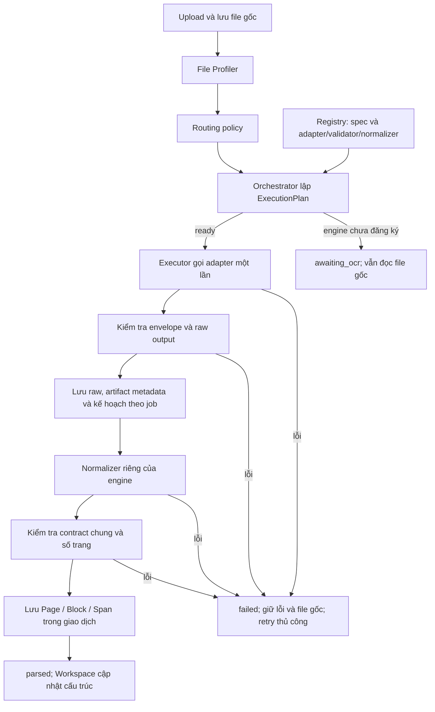

# Kiến trúc Engine Orchestrator của Scanofy

## Mục tiêu và ranh giới

Engine là thành phần mở rộng của Scanofy. API, lưu trữ cấu trúc và Workspace dùng
contract Page–Block–Span, không phụ thuộc định dạng output riêng của engine.
Mỗi engine tự xử lý raw format; orchestrator không đoán raw output theo tên engine.

Vai trò ưu tiên sau đây là chính sách dự kiến, cần benchmark để kiểm chứng:

| Engine | Vai trò ưu tiên | Trạng thái |
| --- | --- | --- |
| MinerU | Document parsing, PDF số, bảng/công thức | Đã đăng ký, chạy thật |
| PaddleOCR | OCR văn bản in, phát hiện vùng chữ | Chưa tích hợp |
| Chandra | Chữ viết tay, biểu mẫu và layout phức tạp | Adapter cũ là placeholder, chưa đăng ký |
| Vintern | OCR/đối chiếu tiếng Việt, tài liệu đặc thù | Chưa tích hợp |

## Luồng đã triển khai — batch nền tảng

`DocumentProcessingService` chỉ điều phối persistence/trạng thái. Nó không import
MinerU và không có `if engine == ...`. `default_orchestrator()` là composition root
đăng ký các engine đã tích hợp. Preview cũng chọn normalizer qua registry.

## Contract orchestration-v1

Các định nghĩa nằm trong `be/app/services/engine_orchestrator.py`:

- **EngineSpec**: tên, vai trò, input types, tasks và scope. Batch hiện chỉ thực thi
  task `document_extraction`, scope `document`.
- **EngineBinding**: spec, adapter, raw validator và normalizer.
- **EngineResult**: envelope Pydantic gồm `engine`, `status=completed`,
  `raw_output` dạng object; Markdown và confidence trung bình tùy chọn.
  Confidence không có giữ null, giá trị có phải trong 0–1; không so sánh điểm giữa engine.
  Field bổ trợ như đường dẫn artifact/stdout được giữ lại.
- **ExecutionPlan**: engine, lý do, input type, task/scope, trạng thái ready hoặc
  awaiting_engine, phiên bản policy/contract và `max_attempts=1`.

Registry từ chối đăng ký trùng tên hoặc tên adapter không khớp spec. Planner kiểm
tra input/task/scope; lựa chọn thủ công engine chưa đăng ký bị từ chối. Lựa chọn
thủ công hiện là API Python nội bộ, chưa nối vào endpoint upload hoặc UI.

Planner dùng `DocumentRouter` hiện có làm policy `routing-v1`: giữ nguyên routing
MinerU/PaddleOCR/Chandra theo evidence. Chưa tự tìm engine thay thế nếu engine
được policy chọn chưa tích hợp. Vai trò trong spec là mô tả, chưa phải bảng xếp hạng.

`ready` nghĩa là có binding hỗ trợ input/task, chưa có health probe cho CLI/model.
CLI thiếu hoặc engine bị tắt được adapter báo lỗi lúc thực thi như trước đây.

Preview lịch sử gọi normalizer qua registry nhưng bỏ raw validator phiên bản hiện
tại để giữ khả năng xem Markdown từ output MinerU cũ. Contract chuẩn hóa vẫn được
kiểm tra. Ngoại lệ chỉ dành cho đọc preview: không dùng để publish hoặc renormalize
snapshot mới; output cũ thiếu geometry vẫn không có overlay bbox.

Raw validator bảo đảm format riêng của engine. Normalizer trả contract chung và
được kiểm tra lại bằng `NormalizedDocument`; source phải khớp engine được chọn.
Engine không có geometry/confidence không được tự tạo các giá trị đó.

## Truy vết và tương thích

- `document.router_decision` giữ các field cũ `engine`, `reason`, `fallback_engine`,
  đồng thời thêm `plan`; frontend hiện tại tiếp tục dùng được.
- Raw của mỗi OCR output giữ `_scanofy.orchestration` gồm `job_id` và plan.
  Metadata artifact/hash/version MinerU có sẵn được giữ nguyên.
- Output lỗi trước khi raw hợp lệ chỉ được ghi trong job error; chưa có bảng attempt
  riêng. Document giữ plan mới nhất, các raw output thành công giữ plan của lần đó.
- Lỗi normalize vẫn giữ raw đã lưu, như pipeline MinerU trước khi refactor.
- Không thay schema database và không backfill dữ liệu người dùng.
- Lệnh `renormalize` hiện vẫn giới hạn MinerU; mở rộng qua registry ở batch phục hồi
  multi-engine sau khi có adapter thứ hai và fixture tương ứng.

## Thêm engine

1. Viết `OCRAdapter.parse(path)` trả `EngineResult` hợp lệ.
2. Viết raw validator và normalizer về Page–Block–Span; thêm fixture và tests.
3. Đăng ký `EngineBinding` tại composition root với capabilities thực tế.
4. Bổ sung routing policy/cấu hình triển khai và smoke test engine thật.

Không thêm nhánh engine vào service persistence hoặc viewer. Nếu engine chỉ nhận
ảnh mà cần xử lý PDF, adapter/worker phải render trang, lưu phép biến đổi tọa độ
và chuẩn hóa về trang nguồn. Đây là phần việc của batch PaddleOCR.
Artifact API hiện dùng thư mục cấu hình mang tên lịch sử `mineru_output_root`;
cần khái quát hóa storage root/manifest trước khi phục vụ artifact của engine thứ hai.

## Các bước mở rộng tiếp theo

1. PaddleOCR: adapter, normalizer, render PDF scan, geometry và artifact storage chung.
2. Chandra: khôi phục integration cũ, lựa chọn loại nội dung trên upload.
3. Vintern: tích hợp và bộ dữ liệu đối chiếu tiếng Việt.
4. Kế hoạch nhiều task theo trang/vùng; provenance và phép biến đổi tọa độ từng task.
5. Quality gate có benchmark, fallback giới hạn ngân sách, lịch sử attempt đầy đủ.
6. Worker/queue bền vững, health/capacity checks, timeout/cancel và giới hạn đồng thời.

Hiện chạy FastAPI background task, một engine và một lần gọi cho mỗi job. Timeout
MinerU do adapter/CLI quản lý. Retry là thao tác tạo job mới; chưa có retry tự động,
fallback, ensemble, hủy inference hay ghép kết quả nhiều engine.

## Kiểm chứng

Tests kiểm tra đăng ký trùng, capability không phù hợp, engine chưa tích hợp,
envelope lỗi, source không khớp và một engine giả có raw format riêng đi qua
service/database mà không sửa nhánh thực thi. MinerU thật được kiểm tra bằng
`python -m tests.live_mineru_smoke` trên SQLite/storage riêng, không dùng Neon.

Ngày 26/11/2026: 53 backend tests qua. Smoke test MinerU 4.2.3 qua trên PDF tổng
hợp một trang: upload response 0,047 giây, toàn bài kiểm tra 14,266 giây; 1 page,
1 block, 1 span; file gốc đọc được trong lúc xử lý, preview/artifact và renormalize
giữ ID span đều qua. Đây là kiểm chứng hồi quy pipeline, chưa phải benchmark OCR.
