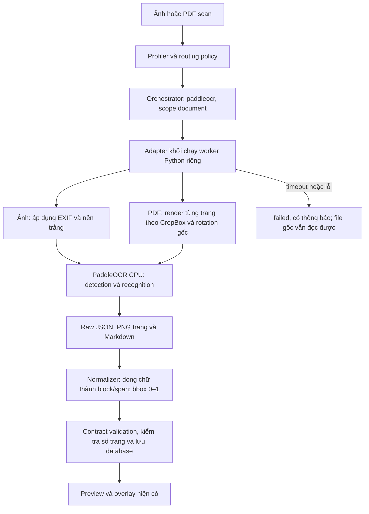

# PaddleOCR trong Scanofy

## Phạm vi đã triển khai

PaddleOCR được đăng ký vào orchestrator dưới vai trò `general_ocr`. Router hiện có
chọn nó cho JPG/JPEG/PNG/WEBP và PDF có evidence scan. PDF số, PDF hỗn hợp và DOCX
tiếp tục qua MinerU. Không cần chọn engine trên giao diện cho batch này.



Không thêm nhánh PaddleOCR vào `DocumentProcessingService`. Adapter, validator và
normalizer được nối tại composition root `default_orchestrator()`.

## Cài và chạy demo

Tại gốc dự án, dùng cùng virtualenv backend đang chạy MinerU:

```powershell
cd be
.\.venv\Scripts\python.exe -m pip install -r requirements-dev.txt
.\.venv\Scripts\python.exe -m pip install -r requirements-paddleocr.txt
.\.venv\Scripts\python.exe -m pip check
.\.venv\Scripts\python.exe -m uvicorn app.main:app --reload
```

PaddleOCR 3.3.2, PaddlePaddle CPU 3.2.2, PaddleX 3.3.13 và PDFium 5.15.2 đã được
kiểm chứng trong `be/.venv` hiện tại. Không cần tạo venv mới. Worker chạy bằng
`sys.executable`, vì vậy cần khởi động API bằng chính môi trường này.

Các biến mới đã có mặc định; có thể thêm vào `be/.env` nếu muốn điều chỉnh:

```env
OCR_OUTPUT_DIR=storage/ocr_outputs
PADDLEOCR_ENABLED=true
PADDLEOCR_LANG=vi
PADDLEOCR_TIMEOUT_SECONDS=900
PADDLEOCR_RENDER_DPI=144
PADDLEOCR_MAX_PAGES=200
PADDLEOCR_MAX_PIXELS=25000000
```

Restart backend sau khi cập nhật code/config. Từ Library, tải ảnh văn bản in tiếng
Việt hoặc PDF scan có ảnh. Tài liệu mới sẽ đi qua `paddleocr_parsing` rồi `parsed`;
Workspace đọc file gốc trong lúc chạy, sau đó có block để chọn/xem nội dung.
Tài liệu cũ đang `awaiting_ocr` cần bấm thử lại để tạo job với code mới.

Lần đầu cần mạng để tải model vào `be/storage/model_cache/paddleocr`; những lần
sau tái sử dụng cache. Thời gian tải model cũng nằm trong timeout. Batch này cố
định dùng CPU và PP-OCRv3; `lang=vi` chọn model nhận dạng Latin có hỗ trợ tiếng Việt.
Không dùng mặc định PP-OCRv5 cho `vi` ở phiên bản đã pin.

## Geometry và ý nghĩa dữ liệu

- PDF render theo trang hiển thị: CropBox và rotation gốc được PDFium áp dụng.
  Pixel bbox chia theo kích thước raster để về tọa độ 0–1 của viewport PDF.js.
- Ảnh được áp dụng EXIF orientation, chuyển RGB với nền trắng khi có alpha.
  Tọa độ tương ứng ảnh đã được trình duyệt hiển thị theo EXIF.
- Tắt document orientation classification, unwarping và textline orientation
  của PaddleOCR để không thêm phép biến đổi geometry chưa được ánh xạ về nguồn.
- Mỗi dòng nhận dạng là một `paragraph` block, kèm một span đại diện cả dòng.
  Chưa có ghép đoạn, phân loại heading, bảng/công thức hoặc word-level spans.
- Giữ thứ tự dòng do engine trả về; chưa bảo đảm reading order tài liệu nhiều cột.
- Polygon gốc giữ trong `raw_json`. Bbox là khung bao chữ nhật; polygon thiếu,
  suy biến hoặc ngoài trang làm bbox null và `needs_review=true`.
- Confidence lấy từ recognition của PaddleOCR, không phải điểm chất lượng tổng
  hợp. `quality_score` và `is_handwritten` giữ null; chưa có quality gate theo ngưỡng.
- Trang trắng vẫn được giữ, có thể không có block/span; không tạo text giả.

Raw contract là `scanofy.paddleocr.v1`, chứa metadata và các trang với width/height
raster, phép biến đổi đã áp dụng và result JSON PaddleOCR. Validator kiểm tra số
trang liên tiếp, kích thước hữu hạn, text/polygon/score đồng bộ và confidence 0–1.

## Artifact, retry và chuẩn hóa lại

Mỗi lần chạy có thư mục riêng `be/storage/ocr_outputs/<document_id>/<run_uuid>/`:

- `paddleocr.json`, `markdown.md`;
- `page-NNNN.png`, `page-NNNN.json`;
- `worker.log` phục vụ chẩn đoán cục bộ, không đưa vào manifest API.

`_scanofy` lưu storage kind, hash file nguồn, phiên bản engine, manifest và plan/job.
API artifact dùng cùng endpoint với MinerU, chỉ đọc file được liệt kê trong manifest.
Storage resolver chỉ chấp nhận root cấu hình, không nhận đường dẫn root tùy ý từ JSON.
Artifact MinerU cũ vẫn ở thư mục cũ; không di chuyển dữ liệu hiện có.
Delete dọn upload cùng cả hai thư mục output, có kiểm tra đường dẫn trước khi xóa.

Worker bị timeout được dừng; lỗi được ghi vào job error. Artifact lỗi còn giữ để
chẩn đoán; retry tạo run mới. Hiện chưa có durable queue, giới hạn tổng số worker
đồng thời hay hủy inference từ UI.

`python -m app.commands.renormalize --document-id <ID>` nay dùng registry cho
output mới nhất của MinerU hoặc PaddleOCR. Mặc định dry-run; thêm `--apply` để
lưu. Không gọi model. Không tự backfill hoặc sửa tài liệu người dùng.

## Kiểm chứng ngày 26/11/2026

- 68 backend tests qua, bao gồm normalizer, giới hạn đầu vào, timeout, EXIF,
  CropBox/rotation (kiểm tra kích thước và vị trí pixel), artifact traversal,
  delete và renormalize giữ ID span.
- `python -m tests.live_paddleocr_smoke`: chạy HTTP server + SQLite/storage riêng,
  ảnh tổng hợp tiếng Việt **1 trang / 3 block / 3 span**, PDF scan tổng hợp
  **2 trang / 6 block / 6 span**. Preview, artifact và delete đều qua.
- Khi đã cache model, hai mẫu tương ứng khoảng **11,250 giây** và **13,156 giây**
  cho toàn bộ thao tác kiểm thử mỗi tài liệu; không phải benchmark inference.
- `python -m tests.live_mineru_smoke`: MinerU 4.2.3 vẫn qua sau khi cài PaddleOCR;
  page/block/span, preview, artifact và renormalize đều hoạt động.
- `pip check`: không có dependency bị thiếu hoặc vi phạm yêu cầu phiên bản.

Các bài kiểm tra model thật là opt-in, chỉ dùng dữ liệu tổng hợp. Chưa đánh giá
CER/WER, handwriting, tài liệu nhiều cột, ảnh mờ/nghiêng và cấu trúc bảng.
Chưa chạy kiểm thử UI bằng trình duyệt trong batch này.

## Tài liệu upstream đã đối chiếu

- [PaddleOCR 3.3.2: Python API, result và bảng ngôn ngữ/model](https://github.com/PaddlePaddle/PaddleOCR/blob/v3.3.2/docs/version3.x/pipeline_usage/OCR.en.md)
- [PDFium Python API và giới hạn thread safety](https://pypdfium2.readthedocs.io/en/stable/python_api.html)
